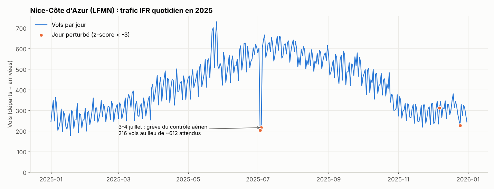
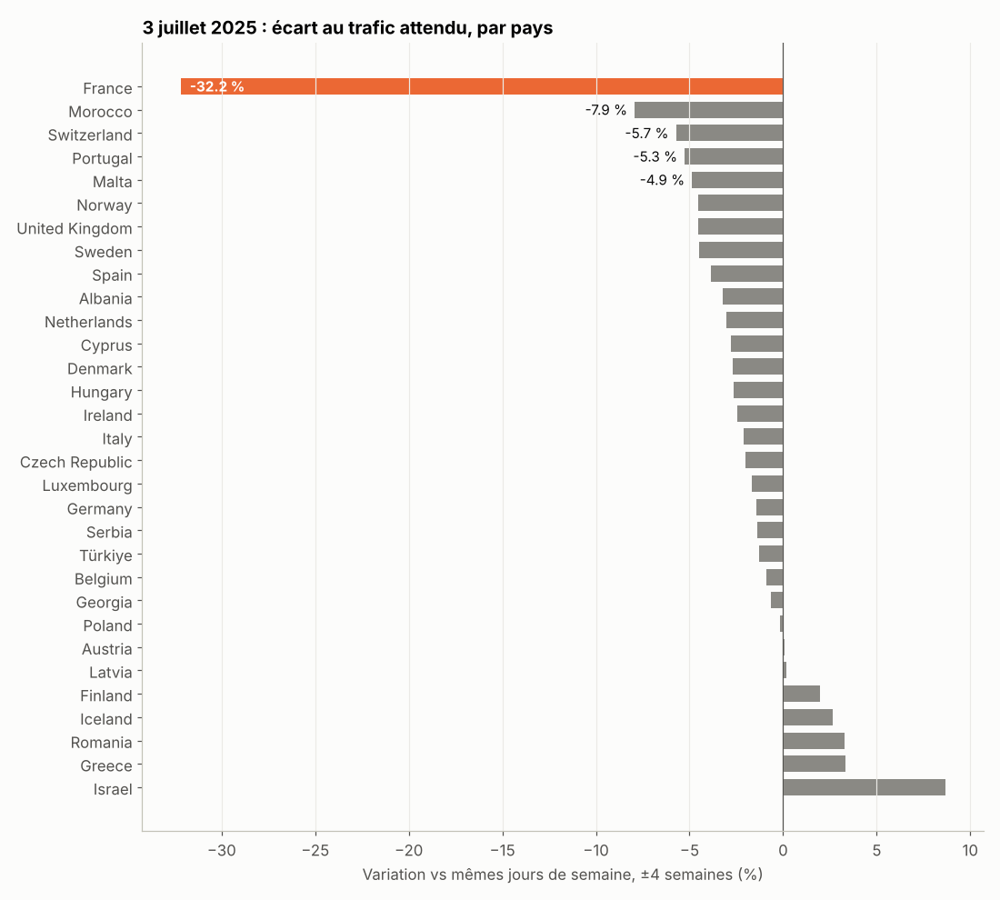
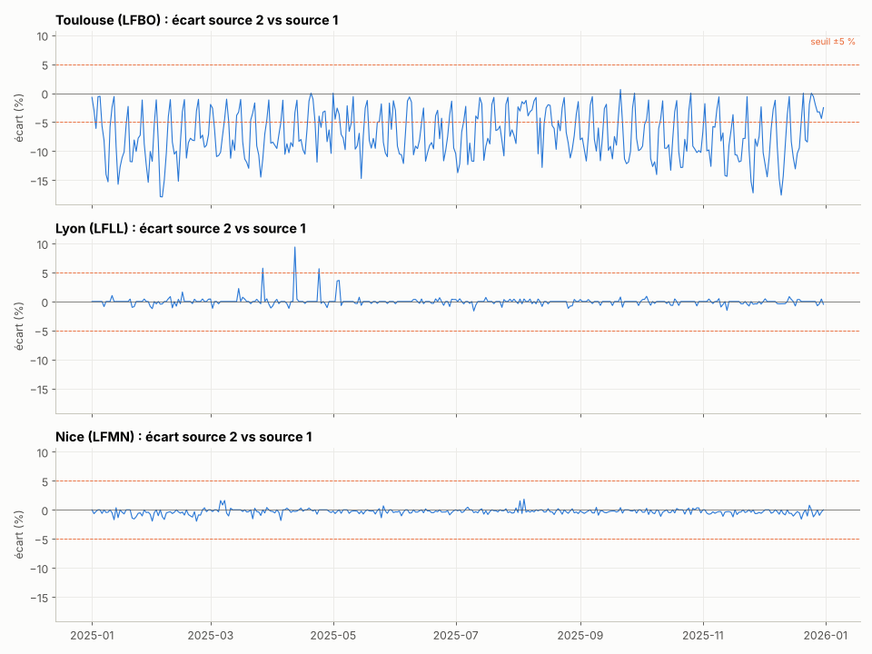
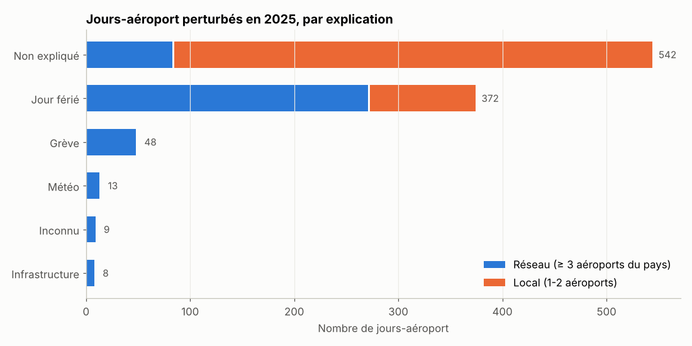

# ✈️ Trafic aérien européen 2025 : fiabilité des données et journées perturbées

> Deux sources comptent les mêmes vols dans 331 aéroports européens. Sont-elles d'accord ? Et quand le trafic s'effondre, peut-on retrouver pourquoi ?

**Stack :** BigQuery (SQL) · Python (pandas, matplotlib) · Google Colab
**Données :** EUROCONTROL, trafic IFR quotidien par aéroport, année 2025 (116 020 lignes, 331 aéroports)
**Notebook :** [Analyse_v2.ipynb sur Colab](https://colab.research.google.com/drive/1GxP7o6GWb2JWhaQXYS9gBlOv-etUvF_C?usp=sharing)



---

## 🎯 Les questions

1. **Fiabilité des données** : le fichier contient deux comptages des mêmes vols (source n°1 et source n°2). Où les deux existent-ils, et concordent-ils ?
2. **Journées perturbées** : quels jours le trafic d'un aéroport s'écarte-t-il anormalement de la normale, et à quels événements réels ces anomalies correspondent-elles ?

Ces questions sont celles d'un travail de **validation de données** : avant d'analyser un chiffre, on vérifie qu'il est fiable, puis on distingue l'événement réel du bruit.

---

## 📌 Résultats clés

| Question | Résultat |
|---|---|
| La source n°2 existe-t-elle partout ? | **Non** : 97 aéroports sur 331 (86 toute l'année, 11 partiellement) |
| Les deux sources concordent-elles ? | **Oui à 93 %** : identiques 30 % des jours, écart ≤ 5 % 63 % des jours, écart > 5 % 7 % des jours |
| Y a-t-il des aéroports systématiquement divergents ? | **Oui** : Münster-Osnabrück, Dresde, Bologne, Toulouse… À Toulouse, l'écart est **permanent** (−5 à −15 % toute l'année), ce qui évoque une différence de définition plutôt qu'un incident |
| La détection retrouve-t-elle des événements réels ? | **Oui**, sans les lui avoir donnés : grève du contrôle aérien français (3-4 juillet), tempête Éowyn (24 janvier), grève de la sûreté en Allemagne (10 mars), panne électrique ibérique (28 avril), grèves en Belgique |
| Quelle part des anomalies est expliquée ? | 992 jours-aéroport perturbés. Les perturbations **réseau** (≥ 3 aéroports d'un pays le même jour) sont majoritairement expliquées ; 83 restent sans explication. Les incidents **locaux** (459 non expliqués) restent à enquêter |
| Une grève nationale se propage-t-elle ? | **Un peu** : le 3 juillet, la France perd 32 % de son trafic, ses voisins entre −4 et −8 % (Maroc, Suisse, Portugal en tête). L'effet est réel mais diffus |



---

## 🔍 Démarche

### 1. Remettre en question ma première version

La v1 de ce projet (notebook `Exploration_Nettoyage_des_données_raw_traffic25.ipynb`) remplaçait les valeurs absentes de la source n°2 par 0, puis supprimait ces lignes comme « hors trafic commercial ». **70 % des données disparaissaient.**

En reprenant le projet, j'ai compris qu'une valeur absente ne veut pas dire « zéro vol » mais « cette source n'a rien transmis ». La v2 conserve toutes les lignes, et cette absence devient la première question de l'analyse.

### 2. Rapprocher les deux sources (SQL)

Pour chaque aéroport et chaque jour : écart absolu, écart relatif (`SAFE_DIVIDE` pour éviter les divisions par zéro) et statut (`identique` / `écart ≤ 5 %` / `écart > 5 %` / `source 2 absente`).



### 3. Détecter les journées anormales (SQL)

Chaque jour est comparé aux **mêmes jours de la semaine, 1 à 4 semaines avant et après** (un lundi se compare à des lundis), avec un z-score :

```
z = (trafic du jour − moyenne des voisins) / écart-type des voisins      → anomalie si z < −3
```

**Une erreur utile** : ma première requête ne regardait que les 8 semaines *précédentes*. Elle signalait fin octobre comme anormal. C'était en fait le **passage à l'horaire d'hiver IATA**, une baisse programmée. Une référence **centrée** (avant et après) a corrigé ce biais.

### 4. Expliquer les anomalies (recherche + SQL)

Les dates les plus touchées ont été recherchées une à une et consignées, avec leur source, dans une table de référence (`data/evenements_2025_v2.csv`), puis jointes aux anomalies en SQL. Chaque anomalie est ensuite classée selon sa **portée** grâce à une fonction de fenêtre (`COUNT(*) OVER (PARTITION BY date, pays)`).

> **Leçon de qualité de données** : ma première version de cette table mélangeait les formats de date et utilisait des noms de pays en français. La jointure ne trouvait rien. Une table de référence doit toujours suivre le format de la table qu'elle rejoint.



---

## 🛠️ Répartition SQL / Python

| Étape | Outil | Fichier |
|---|---|---|
| Nettoyage, typage, renommage (sans supprimer de lignes) | SQL | [`sql/01_staging.sql`](sql/01_staging.sql) |
| Couverture de la source n°2 par aéroport | SQL | [`sql/02_couverture_sources.sql`](sql/02_couverture_sources.sql) |
| Rapprochement des deux sources | SQL | [`sql/03_rapprochement.sql`](sql/03_rapprochement.sql) |
| Détection des jours perturbés (self-join, z-score) | SQL | [`sql/04_jours_perturbes.sql`](sql/04_jours_perturbes.sql) |
| Jointure avec les événements | SQL | [`sql/05_jours_perturbes_annotes.sql`](sql/05_jours_perturbes_annotes.sql) |
| Portée réseau / local (fonction de fenêtre) | SQL | [`sql/06_portee_perturbations.sql`](sql/06_portee_perturbations.sql) |
| Lecture des résultats, graphiques, interprétation | Python | [`Analyse_v2.ipynb`](Analyse_v2.ipynb) |

Chaque requête est commentée en français pour rendre le raisonnement lisible.

---

## ⚠️ Limites

- **Une seule année** (2025) : pas de comparaison avec 2019 ni de tendance pluriannuelle.
- **Seuils simples** : z < −3 et « réseau = au moins 3 aéroports » sont des choix raisonnables mais arbitraires.
- **Annotation manuelle** des événements, non exhaustive : les incidents locaux ne sont pas expliqués.
- La **définition exacte des deux sources** reste à confirmer dans la documentation EUROCONTROL.

## 🔮 Pistes

- Passer les requêtes en **modèles dbt**, avec des tests de qualité automatiques.
- Détecter aussi les **pics** (z > +3), comme les grands événements ou l'afflux d'aviation d'affaires (fin mai à Nice).
- Croiser avec les **retards ATFM** publiés par EUROCONTROL.

---

## 📂 Structure du dossier

```
Airports_Traffic_25/
├── README.md
├── Analyse_v2.ipynb                                 ← analyse v2 (ce projet)
├── Exploration_Nettoyage_des_données_raw_traffic25.ipynb   ← v1, conservée pour l'historique
├── sql/
│   ├── 01_staging.sql
│   ├── 02_couverture_sources.sql
│   ├── 03_rapprochement.sql
│   ├── 04_jours_perturbes.sql
│   ├── 05_jours_perturbes_annotes.sql
│   └── 06_portee_perturbations.sql
├── data/
│   ├── raw/airport_traffic_2025.csv                 ← données EUROCONTROL (via Kaggle)
│   └── evenements_2025_v2.csv                       ← événements annotés et sourcés
└── figures/                                         ← graphiques du README
```

## 🚀 Reproduire l'analyse

1. Ouvrir `Analyse_v2.ipynb` dans Google Colab.
2. Remplacer `PROJET` par son propre projet Google Cloud (le mode sandbox gratuit de BigQuery suffit).
3. Passer `RECONSTRUIRE = True` et lancer la cellule : elle demande les deux CSV de `data/`, crée les tables puis les vues SQL.
4. Exécuter le reste du notebook dans l'ordre.

---

## 🤝 Méthode de travail

Projet réalisé avec l'aide de Claude (Anthropic) pour le cadrage, la relecture du code et la vérification des résultats. Les choix d'analyse, l'enquête sur les événements et l'interprétation sont les miens.

**Valentin Rouquier** · [GitHub](https://github.com/valrqr)
