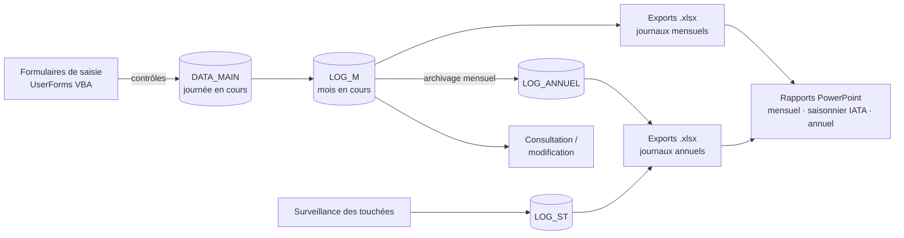
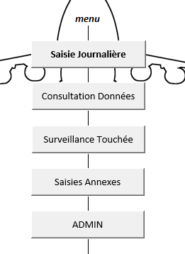
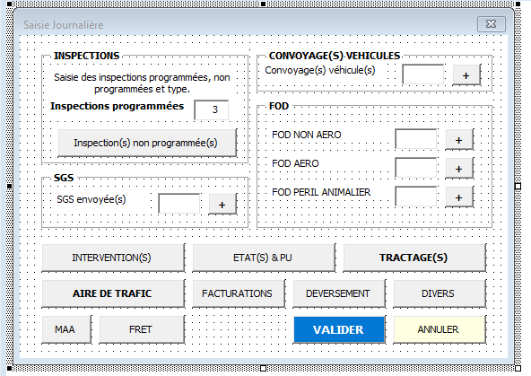
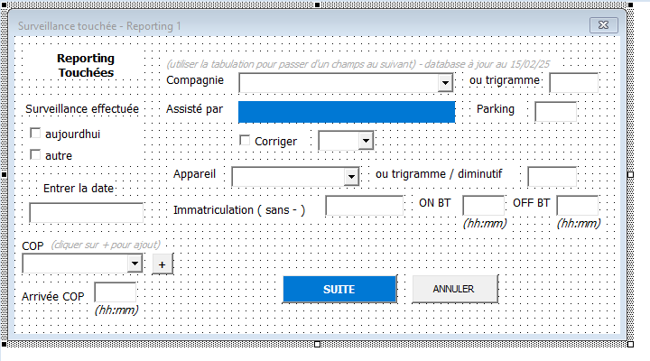
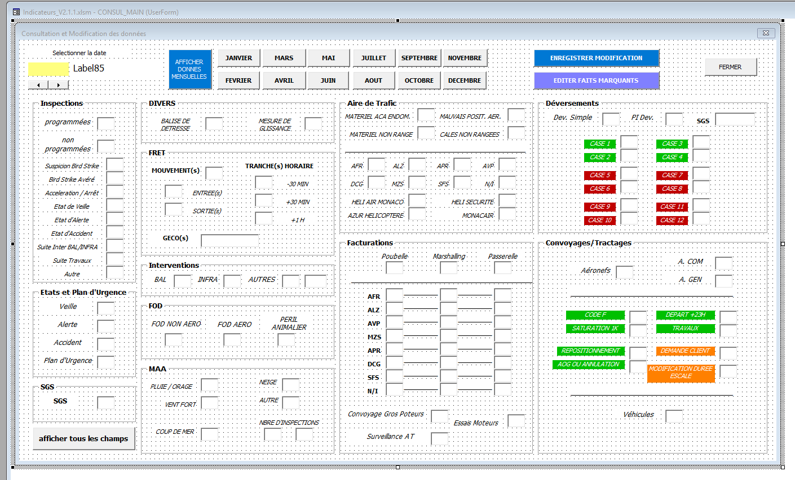

# Indicateurs.xlsm — Saisie, suivi et reporting des opérations côté piste

> Projet professionnel réalisé chez **Aéroports de la Côte d'Azur**, en Excel & VBA.
> Version présentée : **V2.1.1**

Un outil métier qui remplace la collecte dispersée des données d'activité côté piste par **une saisie quotidienne guidée et contrôlée**. Les indicateurs sont ensuite **calculés, archivés et exportés automatiquement** pour alimenter les rapports PowerPoint **mensuels, saisonniers (saisons IATA) et annuels**.

---

## 🎯 Le besoin

Chaque jour, l'équipe des opérations enregistre l'activité côté piste : inspections, péril animalier, objets étrangers sur les aires (FOD), déversements, convoyages et tractages d'avions, fret, phénomènes météo, états d'alerte, prestations à facturer aux assistants en escale…

L'enjeu était de :
- **fiabiliser la saisie**, avec des données complètes, cohérentes et au bon format ;
- **centraliser** l'activité au même endroit, jour après jour ;
- **produire sans effort** les rapports d'activité mensuels, saisonniers et annuels, ainsi que les éléments de facturation.

## ⚙️ Ce que fait l'outil

| Module | Rôle |
|---|---|
| **Saisie journalière** | Un formulaire principal et des sous-formulaires par thème : inspections, FOD, SGS, convoyages, tractages, déversements, fret, météo (MAA), interventions, facturations… |
| **Consultation des données** | Retrouver et modifier n'importe quelle journée, afficher les données d'un mois, éditer les faits marquants |
| **Surveillance des touchées** | Suivi des escales par compagnie, type d'appareil, immatriculation et horaires (ON / OFF block) |
| **Saisies annexes** | Facturations, permis et formations, carburant, grille des prix des prestations |
| **Administration** | Accès protégé, mise à jour des référentiels, édition des logs |

### Contrôles de saisie
L'outil bloque la validation tant que les données ne sont pas cohérentes. Le code contient plus de 200 messages de contrôle. Quelques exemples :
- les totaux doivent correspondre au détail saisi (nombre de convoyages contre types de convoyage, inspections non programmées contre leurs motifs) ;
- certains champs deviennent obligatoires selon le contexte : un déversement impose un numéro de SGS, une saisie de fret impose un numéro GECO ;
- les formats imposés sont vérifiés (heures en hh:mm, numéros séparés par des virgules) ;
- l'outil protège contre les doubles saisies : une fois la journée validée, les corrections passent par la consultation.

### Automatisations
- **À l'ouverture du fichier**, l'outil détecte le changement de jour, de mois ou d'année et prépare les tableaux correspondants.
- **Archivage mensuel** : 16 procédures transfèrent les données du mois dans les journaux, puis remettent la saisie à zéro.
- **Édition des rapports** mensuels, annuels, logistique et surveillances : chacun est exporté en `.xlsx` avec des valeurs figées, prêt à être diffusé.
- **Export pour les rapports PowerPoint** : les données consolidées sont exportées automatiquement, puis compilées dans les rapports d'activité **mensuels**, **saisonniers** (saison IATA été / hiver) et **annuels** présentés à la direction.

## 🏗️ Architecture

Le classeur fonctionne comme une **petite base de données** : les utilisateurs ne voient que les formulaires. Les données vivent dans des feuilles techniques masquées, et des plages nommées assurent le lien entre formulaires et données.



| Élément | Volume |
|---|---|
| Modules VBA | 26 (25 formulaires + 1 module standard) |
| Lignes de code | environ 10 600 |
| Procédures | environ 480 |
| Feuilles techniques | une quinzaine (saisie, journaux mensuels et annuels, surveillances, synthèse, compte rendu) |

## 🖼️ Aperçu

| Menu général | Saisie journalière |
|---|---|
|  |  |

| Surveillance des touchées | Déversements |
|---|---|
|  |  |

**Consultation et modification des données**


## 📂 Contenu du dossier

```
Indicateurs/
├── README.md
├── src/
│   ├── forms/                 # les 25 formulaires exportés (.frm) et le module standard
│   ├── modules/
│   │   └── code_vba_complet.bas   # tout le code, extrait avec olevba
│   └── _INDEX.txt             # liste des modules et de leurs procédures
└── docs/
    └── screenshots/           # captures des formulaires
```

## 💡 Ce que ce projet montre

- **Partir du terrain** : l'outil a été conçu par et pour l'équipe qui l'utilise au quotidien.
- **La qualité des données à la source** : contrôler au moment de la saisie plutôt que corriger après coup.
- **Une modélisation déjà structurée** : la séparation entre saisie, stockage, archivage et restitution annonce les briques d'un pipeline de données.
- **L'automatisation des tâches répétitives** : archivage et exports en un clic.
- **Une restitution pensée pour la décision** : des rapports réguliers à trois horizons (mois, saison IATA, année) pour la direction.

## 🔭 Avec le recul : ce que je ferais aujourd'hui

Ma formation de Data Analyst m'a appris à voir les limites d'Excel utilisé comme base de données. Voici comment je referais cet outil aujourd'hui :

| Aujourd'hui (V2.1.1) | Version moderne |
|---|---|
| Feuilles Excel masquées | Une base SQL (ou BigQuery) |
| Plages nommées pour faire le lien | Un modèle de données en étoile (faits / dimensions) |
| Exports `.xlsx` compilés en rapports PowerPoint | Un tableau de bord Power BI actualisé automatiquement, avec des vues mois / saison IATA / année |
| Archivage par macros | Des transformations planifiées (dbt, Airflow) |
| Formulaires VBA | Un formulaire web ou une application légère |
