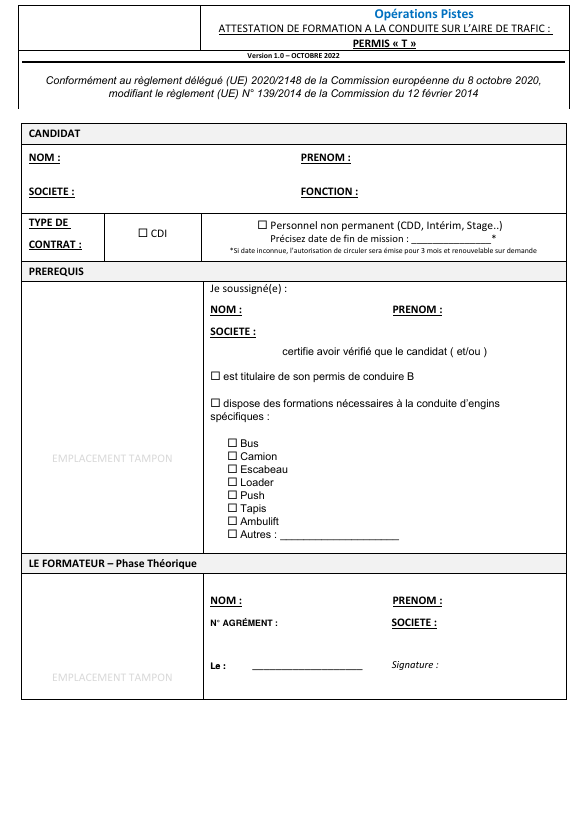
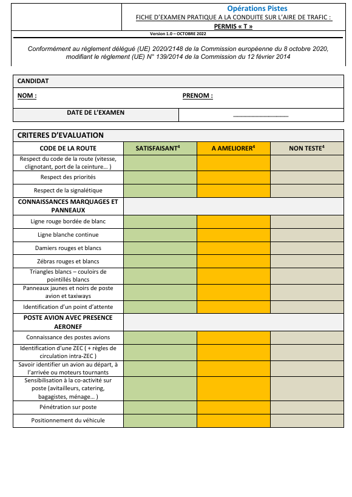

# Permis pistes — Examens et documents de suivi des autorisations de conduite côté piste

> Projet professionnel réalisé chez **Aéroports de la Côte d'Azur**.
> Documents version 1.0 — octobre 2022

Pour conduire un véhicule sur les aires aéronautiques d'un aéroport, il faut une **autorisation de conduite délivrée par l'exploitant**, couramment appelée « permis piste ». Le **permis T** couvre l'aire de trafic, c'est-à-dire les zones de stationnement et de circulation autour des avions.

Ce dossier regroupe les outils que j'ai conçus pour encadrer ce processus : une banque de questions avec un générateur de QCM pour l'examen théorique, et les modèles de documents qui assurent la traçabilité de la formation et de l'examen pratique.

---

## 🎯 Le besoin

Le règlement délégué (UE) 2020/2148, qui modifie le règlement (UE) n° 139/2014, impose un parcours précis avant de délivrer une autorisation de conduite côté piste :
- une **formation théorique** suivie d'un **examen théorique** ;
- une **formation pratique** suivie d'un **examen pratique**, avec un **examinateur différent du formateur** ;
- la **preuve écrite** de chaque étape.

Les candidats viennent de nombreuses sociétés (assistants en escale, compagnies, prestataires, intérimaires), et les formateurs agréés peuvent appartenir à ces mêmes sociétés. Il fallait donc **standardiser** les examens et les documents, quel que soit le formateur.

## ⚙️ Ce que contient le dossier

### 1. Banque de questions et générateur de QCM *(à ajouter)*
Un classeur Excel & VBA qui contient la banque de questions des examens théoriques et génère un **QCM aléatoire selon le type de permis**. Il peut produire **deux QCM différents d'affilée**.

### 2. Attestation de formation — Permis T
Le document qui suit le candidat tout au long du parcours :
- **le candidat** : identité, société, fonction, type de contrat. Pour un contrat temporaire sans date de fin connue, l'autorisation est émise pour 3 mois et renouvelable ;
- **les prérequis**, certifiés par l'employeur : permis B et formations aux engins spécifiques (bus, camion, escabeau, loader, push, tapis, ambulift…) ;
- **quatre visas**, chacun avec nom, numéro d'agrément, date, signature et tampon : formateur théorique, examinateur théorique, formateur pratique et examinateur pratique ;
- **l'attestation signée par le candidat**.

### 3. Fiche d'examen pratique — Permis T
La grille utilisée par l'examinateur lors de l'épreuve en conditions réelles. Chaque critère est noté **Satisfaisant / À améliorer / Non testé**, en cinq blocs :
- **code de la route** : vitesse, priorités, signalisation ;
- **marquages et panneaux** : lignes, damiers, zébras, panneaux de poste avion et de taxiway, points d'attente ;
- **poste avion avec un aéronef présent** : zone d'évolution contrôlée (ZEC), avion au départ / à l'arrivée / moteurs tournants, co-activité sur le poste, positionnement du véhicule ;
- **traversée de taxiway** : priorité aux aéronefs, souffle des réacteurs, STOP et double STOP, trafic environnant ;
- **spécificités de la plateforme** et **changements terrain** survenus depuis la dernière formation du candidat.

La règle de réussite est stricte : **un seul critère « À améliorer » ou « Non testé » est éliminatoire**.

Les deux PDF sont des **formulaires remplissables**.

## 🖼️ Aperçu

| Attestation de formation | Fiche d'examen pratique |
|---|---|
|  |  |

## 📂 Contenu du dossier

```
Permis_pistes/
├── README.md
├── modeles/
│   ├── Permis_T_attestation_formation.pdf
│   └── Permis_T_fiche_examen_pratique.pdf
└── docs/                       # aperçus des modèles
```

> 🔒 Les modèles publiés ont été anonymisés : logos, codes de service internes et métadonnées retirés. Ils ne contiennent aucune donnée de candidat.

## 💡 Ce que ce projet montre

- **Traduire un règlement en processus concret** : chaque exigence du texte devient un champ, un visa ou une règle de la grille.
- **Standardiser pour fiabiliser** : la même grille et les mêmes critères pour tous les candidats, quel que soit l'examinateur.
- **La traçabilité** : qui a formé, qui a examiné, quand et avec quel résultat, de quoi justifier chaque autorisation lors d'un audit.

## 🔭 Avec le recul : ce que je ferais aujourd'hui

| Aujourd'hui | Version moderne |
|---|---|
| Formulaires PDF remplis puis archivés | Un formulaire numérique qui alimente directement une base des autorisations |
| QCM générés dans Excel puis imprimés | Un QCM en ligne corrigé automatiquement, avec l'historique des réponses |
| Suivi des échéances à la main | Des relances automatiques avant l'expiration des autorisations temporaires |
| Pas de vue d'ensemble | Un tableau de bord : taux de réussite par question, par type de permis et par organisme de formation, pour repérer les questions mal comprises et améliorer la formation |
