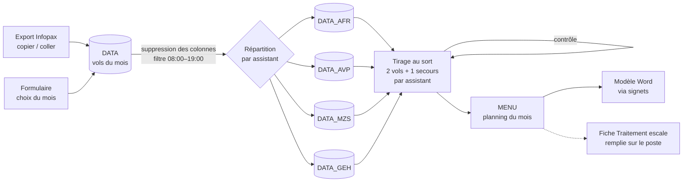
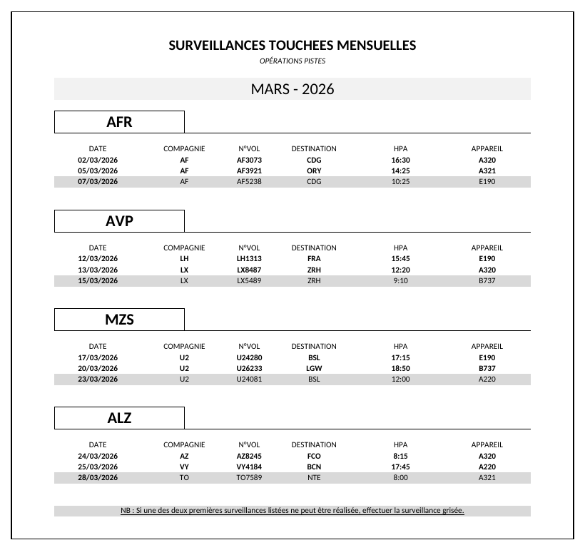
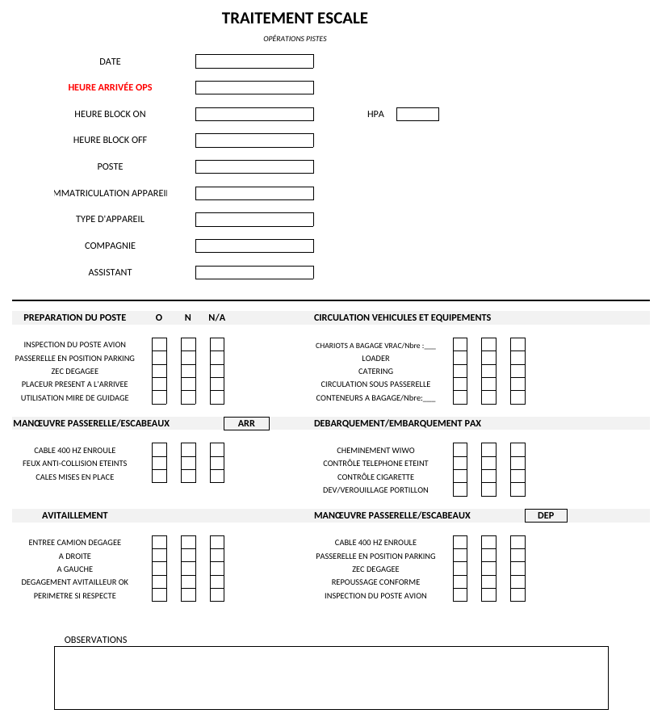

# STX.xlsm — Planning mensuel des surveillances d'escales (« touchées »)

> Projet professionnel réalisé chez **Aéroports de la Côte d'Azur**, en Excel & VBA.
> Version présentée : **V1.4**

Un outil qui transforme l'export brut des vols du mois (programme **Infopax**) en **planning de surveillances tirées au sort**, réparti entre les assistants en escale, puis l'exporte dans le modèle Word diffusé à l'équipe. La fiche de contrôle utilisée sur le poste avion est intégrée au classeur.

---

## 🎯 Le besoin

Une **touchée** est l'escale d'un avion : il arrive sur son poste de stationnement, il est traité (débarquement, avitaillement, bagages, catering…) puis il repart. Ces opérations sont réalisées par les **assistants en escale**, des sociétés prestataires qui doivent appliquer les règles d'exploitation édictées par l'aéroport.

En tant que Coordinateur des opérations, une de nos missions était de **vérifier sur le terrain que ces règles étaient respectées**, en assistant à des escales réelles avec une grille de contrôle.

Cadre réglementaire :
- l'exploitant d'aérodrome certifié doit surveiller la conformité de ses activités, **y compris celles des tiers qui interviennent sur la plateforme** (règlement (UE) n° 139/2014, ADR.OR.D.005) ;
- en France, l'agrément des assistants en escale les engage à respecter les **consignes d'exploitation de l'exploitant d'aérodrome** ;
- à partir du **27 mars 2028**, l'assistance en escale aura son propre cadre européen de sécurité (règlement délégué (UE) 2025/20).

L'enjeu était de :
- **répartir équitablement** les contrôles entre les assistants, chaque mois ;
- **choisir les vols au hasard** pour qu'un assistant ne puisse pas anticiper les contrôles et ne « soigner » que certaines escales ;
- **produire le planning en quelques clics**, au lieu de le construire à la main à partir de plusieurs milliers de lignes de programme.

## ⚙️ Ce que fait l'outil

| Étape | Ce qui se passe |
|---|---|
| **1. Import** | Le coordinateur colle l'export Infopax du mois (copier / coller manuel) dans la feuille `DATA` |
| **2. Choix du mois** | Un formulaire demande de confirmer le mois des données extraites |
| **3. Préparation** | La macro supprime les 40 colonnes inutiles de l'export, ne garde que les vols entre **08:00 et 19:00** (créneau retenu pour les surveillances) et répartit les vols par assistant dans quatre feuilles : AFR, AVP, MZS et un groupe ALZ (deux codes regroupés) |
| **4. Tirage au sort** | Chaque assistant a sa semaine du mois (1–7, 8–15, 16–23, 24–28). Dans cette fenêtre, l'outil tire **2 vols au hasard, sur deux jours différents**, et prévoit **1 vol de secours** (affiché en grisé) en fin de semaine |
| **5. Contrôle du tirage** | Une cellule de contrôle vérifie chaque tirage (bornes respectées, deux vols distincts et dans l'ordre, jours tous différents). Tant que ce n'est pas le cas, l'outil retire au sort |
| **6. Diffusion** | Un bouton relance le tirage, un autre remet l'outil à zéro et un dernier remplit le **modèle Word du planning** via 38 signets (mois, année, puis date, intitulé du vol et heure prévue d'arrivée de chaque surveillance) |

### La fiche de surveillance « Traitement escale »
Le classeur contient aussi la grille remplie sur le poste avion : horaires (arrivée de l'agent, block ON / OFF), poste, type d'appareil, compagnie, assistant, puis une trentaine de points cotés **O / N / N/A**, regroupés par phase :
- **préparation du poste** : inspection du poste, passerelle en position parking, zone d'évolution contrôlée (ZEC) dégagée, placeur présent… ;
- **arrivée et départ** : câble 400 Hz enroulé, feux anticollision éteints, cales en place, repoussage conforme… ;
- **avitaillement** : entrée du camion dégagée, périmètre de sécurité respecté… ;
- **circulation des véhicules et équipements** et **débarquement / embarquement des passagers** (cheminement piéton, téléphones éteints, interdiction de fumer…).

## 🏗️ Architecture



| Élément | Volume |
|---|---|
| Modules VBA | 2 (1 formulaire + 1 module standard) |
| Lignes de code | environ 420 |
| Procédures | 15 |
| Feuilles | 9 (dont 2 fiches de surveillance masquées) |
| Plages nommées | 75 |

## 🖼️ Aperçu

*Captures réalisées sur une copie du classeur alimentée avec des **vols fictifs** (compagnies, numéros de vol et horaires inventés).*

| Planning mensuel généré | Fiche « Traitement escale » |
|---|---|
|  |  |

## 📂 Contenu du dossier

```
STX/
├── README.md
├── src/
│   ├── forms/
│   │   ├── STX.frm                # formulaire de choix du mois + préparation et tirage
│   │   └── MAIN.bas               # nouveau tirage, remise à zéro, export Word
│   ├── modules/
│   │   └── code_vba_complet.bas   # tout le code, extrait avec olevba
│   └── _INDEX.txt                 # liste des modules et de leurs procédures
└── docs/
    └── screenshots/               # captures réalisées avec des données fictives
```

> 🔒 Le classeur d'origine n'est pas publié : il contient des données d'exploitation de l'aéroport. Les chemins réseau internes ont été masqués dans le code (`X:\...\`) et les captures ont été produites avec des données fictives.

## 💡 Ce que ce projet montre

- **Un échantillonnage aléatoire stratifié avant l'heure** : un tirage sans remise, par assistant et par semaine, avec des règles métier (jours différents, créneau horaire imposé).
- **La préparation de données brutes** : nettoyer un export, filtrer et ventiler des milliers de lignes de manière reproductible.
- **Des contrôles automatiques** : le tirage n'est accepté que s'il respecte toutes les règles.
- **Un outil au service de la sécurité** : des contrôles imprévisibles, équitablement répartis, et une grille identique pour tous.

## 🔭 Avec le recul : ce que je ferais aujourd'hui

En relisant ce code avec mes compétences de Data Analyst, voici ce que je changerais :

| Aujourd'hui (V1.4) | Version moderne |
|---|---|
| Copier / coller manuel de l'export Infopax | Import automatique du fichier, colonnes repérées par leur nom et non par leur position |
| 8 procédures de tirage quasi identiques (une par assistant, en double) | Une seule fonction paramétrée, par exemple `df.groupby("assistant").sample(2)` en pandas |
| Boucle « tant que le tirage n'est pas valide » | Tirage directement parmi les jours éligibles, sans risque de boucle infinie si un assistant a peu de vols |
| Semaines codées en dur (les jours 29 à 31 ne sont jamais tirés) | Fenêtres calculées selon le nombre de jours du mois |
| Résultats des fiches papier non exploités | Une table des contrôles (point par point) et un tableau de bord Power BI : taux de conformité par assistant, par phase et dans le temps |
